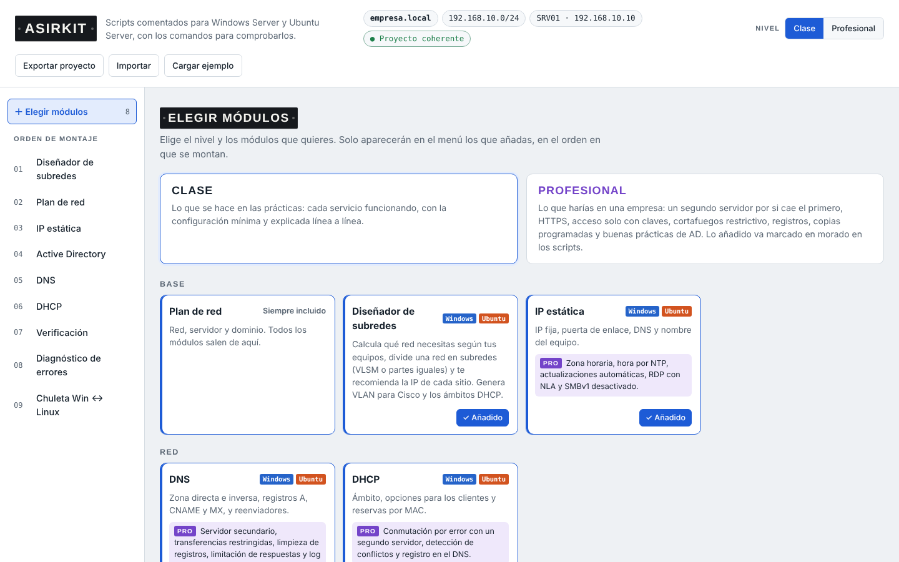
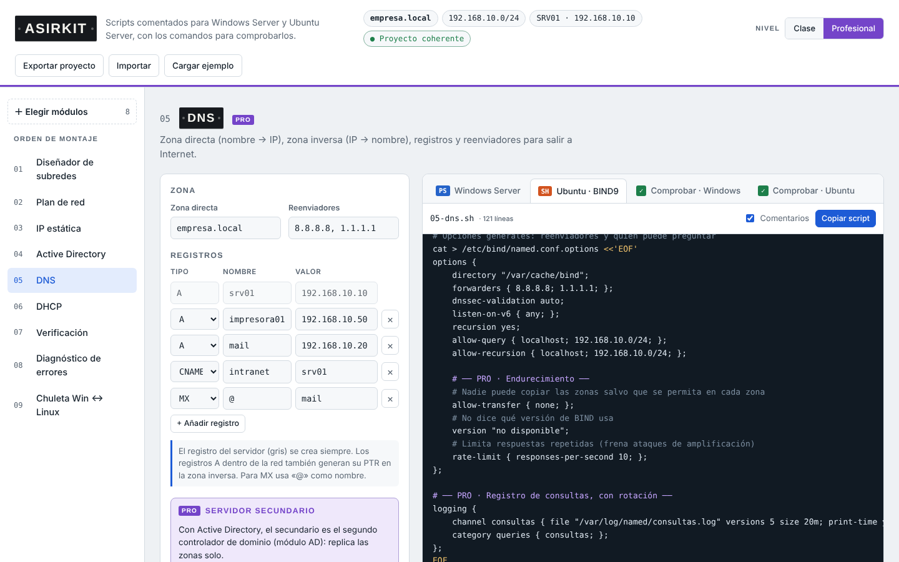
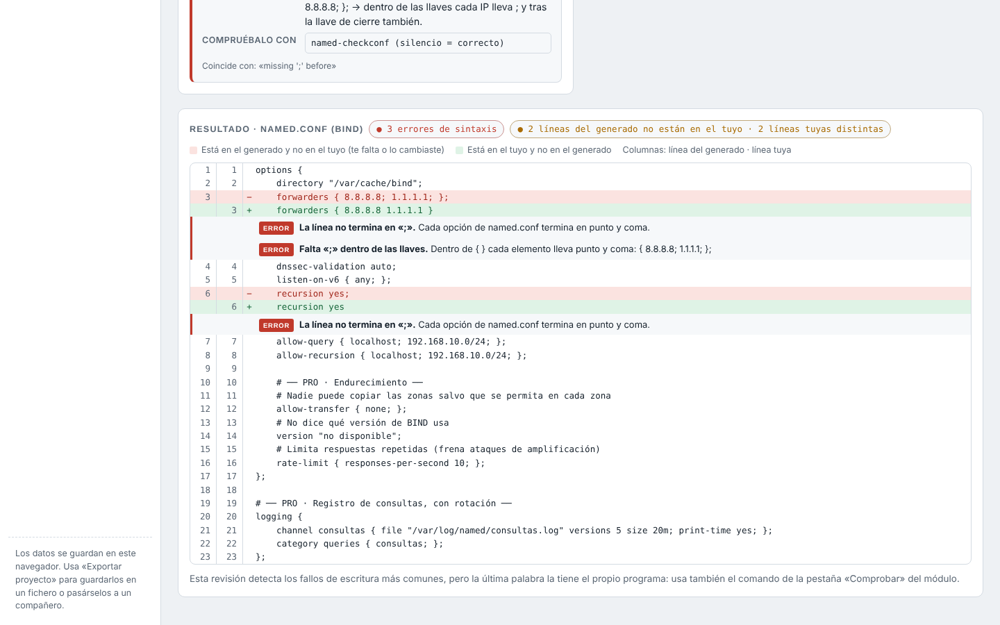
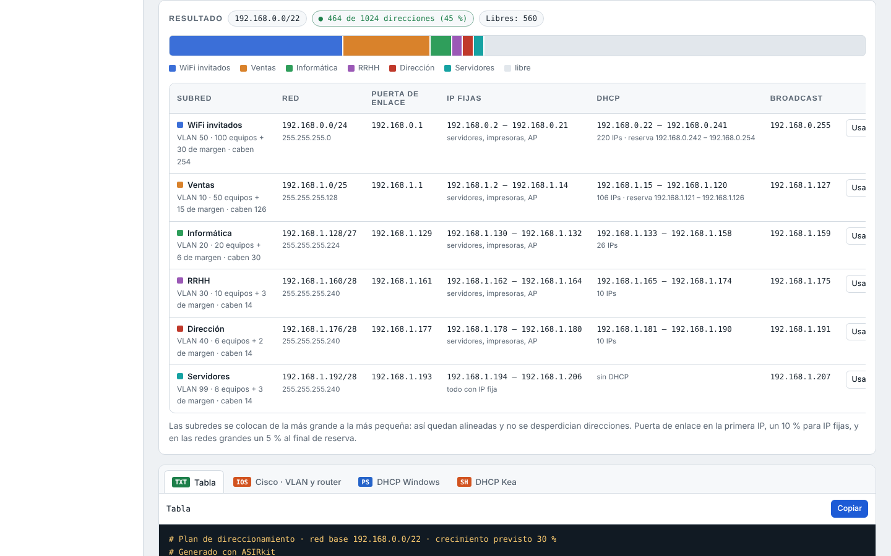

# ASIRkit

**Generador de configuraciones para Windows Server y Ubuntu Server.** Eliges los servicios y el nivel, rellenas el plan de red una vez y cada módulo te da el script listo para ejecutar, comentado línea a línea, junto con los comandos para comprobar que todo ha quedado bien.

Pensado para quienes estudian **ASIR / SMR** y para técnicos de sistemas que montan siempre lo mismo: Active Directory, DHCP, DNS, ficheros, web… sin errores de escritura y con todo coherente entre sí.

**▶ Pruébala: https://krmivan.github.io/asirkit/**

> Funciona entera en el navegador: es un único `index.html`, sin servidor, sin instalar nada y sin enviar datos a ningún sitio.



## Qué hace

| Módulo | Windows Server | Ubuntu Server |
|---|---|---|
| **Diseñador de subredes** | VLSM según los equipos de cada zona, partes iguales y calculadora de IP en binario. Genera VLAN para Cisco y los ámbitos DHCP | |
| **Plan de red** | Red, servidor y dominio. Mapa de direcciones y validación de que todo cuadra | |
| **IP estática** | `New-NetIPAddress`, DNS y nombre del equipo | netplan y `hostnamectl` |
| **Active Directory** | Bosque, OUs, grupos y usuarios desde un CSV; unir clientes | Unir Ubuntu al dominio con realmd + SSSD |
| **DNS** | Zonas directa e inversa, registros A/CNAME/MX, reenviadores | BIND9 |
| **DHCP** | Ámbito, opciones y reservas | Kea o isc-dhcp-server |
| **Directivas de grupo** | Contraseñas, panel de control, CMD, USB, fondo | — |
| **Servidor de ficheros** | SMB con permisos NTFS por departamento | Samba |
| **Servidor web** | IIS | Apache |
| **FTP** | IIS FTP | vsftpd |
| **SSH** | OpenSSH | OpenSSH |
| **Cortafuegos** | Windows Defender Firewall | UFW |
| **Copias de seguridad** | Windows Server Backup | tar + cron / rsync |
| **Verificación** | Script que marca en verde o rojo cada servicio | Igual en bash |

Los scripts se pueden ejecutar varias veces sin romper nada (comprueban si cada cosa existe antes de crearla) y nunca guardan contraseñas: las piden al ejecutarse.

## Dos niveles: Clase y Profesional

- **Clase:** lo que se hace en las prácticas, con la configuración mínima y explicada.
- **Profesional:** lo que se haría en una empresa. Segundo servidor para DHCP, DNS y AD, HTTPS, SSH solo con claves y Fail2ban, cortafuegos restrictivo, modelo AGDLP, papelera de AD, cuotas, copias incrementales con réplica fuera del servidor… Todo lo añadido va marcado en morado dentro del script.



## Comprobar y diagnosticar

- Cada módulo tiene una pestaña **Comprobar** con los comandos que validan la sintaxis y el resultado (`named-checkzone`, `kea-dhcp4 -t`, `testparm`, `apache2ctl configtest`, `sshd -t`, el analizador de PowerShell…) y lo que debería salir.
- **Diagnóstico de errores:** pegas un mensaje de error y te explica qué significa, por qué pasa y cómo arreglarlo (reconoce más de 50 errores habituales, en español y en inglés).
- **Revisar un fichero:** pegas tu fichero de configuración y detecta puntos y coma que faltan, llaves sin cerrar, tabuladores en YAML, nombres sin punto final en las zonas, espacios en `vsftpd.conf`, comillas copiadas de Word… y lo compara línea a línea con el que genera ASIRkit.



## Diseñador de subredes

Indicas cuántos equipos hay en cada departamento o zona y te calcula la subred justa para cada una (con margen de crecimiento), la puerta de enlace, el tramo de IP fijas y el rango DHCP. Con un botón pasas cualquier subred al plan de red del proyecto.



## Cómo usarla

1. Abre la [demo](https://krmivan.github.io/asirkit/) o descarga el repositorio y abre `index.html` en el navegador.
2. Elige el nivel y los módulos.
3. Rellena el plan de red y revisa que no haya avisos.
4. Copia cada script y ejecútalo en el servidor, en el orden del menú.
5. Pasa el script de **Verificación** y, si algo falla, usa la pestaña **Comprobar** o el **Diagnóstico de errores**.

Los datos se guardan en tu navegador. Con **Exportar proyecto** te llevas un JSON para cargarlo en otro equipo o pasárselo a un compañero.

> ⚠️ Prueba siempre los scripts en máquinas virtuales antes de usarlos en un servidor real.

## Cómo está hecha

HTML, CSS y JavaScript sin frameworks ni dependencias. El código está separado por módulos en `src/` y `build.py` lo junta en un solo `index.html`:

```
src/
├── plantilla.html          estructura de la página
├── estilos.css             estilos (tema claro y oscuro)
└── js/
    ├── 01-estado.js        datos del proyecto, catálogo y validación
    ├── 02-ip-dhcp-dns.js   generadores de IP, DHCP y DNS
    ├── 03-ad-gpo-servicios.js
    ├── 04-cortafuegos-copias-verificacion.js
    ├── 05-comprobar.js     pestañas «Comprobar»
    ├── 06-diagnostico.js   base de errores, revisor de ficheros y comparador
    ├── 07-chuleta.js       comandos equivalentes Windows ↔ Linux
    ├── 08-interfaz.js      formularios y pintado
    ├── 09-subredes.js      VLSM, partes iguales y calculadora
    └── 10-eventos.js       eventos y arranque
```

```bash
python3 build.py   # genera index.html
```

## Hoja de ruta

Próximos servidores y servicios en preparación. Las ideas y sugerencias son bienvenidas en *Issues*.

## Autor

**Iván Juliana**, estudiante de Administración de Sistemas Informáticos en Red (ASIR). [LinkedIn](https://www.linkedin.com/in/ivanjulval)

## Licencia

[MIT](LICENSE)
